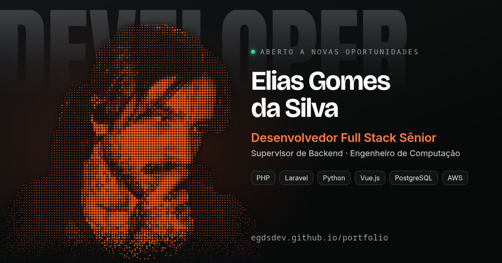

# Portfólio — Elias Gomes da Silva

**Desenvolvedor Full Stack Sênior · Supervisor de Backend · Engenheiro de Computação**

🔗 **Site:** https://egdsdev.github.io/portfolio/ · **LinkedIn:** [/in/egdsdev](https://www.linkedin.com/in/egdsdev/) · **Currículo:** [PDF](https://egdsdev.github.io/portfolio/curriculo-elias-gomes.pdf)



Portfólio pessoal com analytics próprio: além de apresentar experiência, cases e stack, ele mede
como recrutadores navegam (origem, seções lidas, downloads de currículo e contatos) e mostra tudo
num painel administrativo em tempo real.

## Destaques técnicos

- **Intro em canvas** — retrato em halftone com milhares de partículas que reagem ao mouse/toque e,
  ao rolar a página, descem em fluxo para compor a foto do hero. Otimizada para celular: o miolo
  parado vira uma camada em cache, a quantidade de partículas se adapta ao aparelho e a animação
  dorme sem interação.
- **Analytics próprio no Firestore** — visitas, seções vistas, cliques em CTA e jornadas por sessão,
  com score de interesse por visitante.
- **Painel admin em tempo real** — dados via `onSnapshot`, mapa ao vivo (Leaflet) sincronizado com a
  lista de visitantes, funil de recrutamento, CTR por CTA e leads.
- **Performance** — SDK do Firebase carregado sob demanda: JavaScript inicial de ~1 MB para ~519 KB.
- **Currículo otimizado para ATS** — gerado de HTML para PDF com Puppeteer (`scripts/`), com texto
  extraível na ordem certa para triagem por IA.
- **SEO e compartilhamento** — dados estruturados (JSON-LD), Open Graph com imagem própria e sitemap.

## Stack

Angular 20 (standalone components, signals) · TypeScript · Tailwind CSS v4 · Firebase
(Firestore, Auth, Storage, Cloud Functions) · Leaflet · Chart.js · Canvas 2D · Puppeteer

## Estrutura

```
src/app/core/        serviços (Firebase, analytics) e guard do admin
src/app/features/    seções do site (intro, hero, experiência, cases, skills…) e o painel admin
src/app/shared/      componentes e diretivas compartilhados
functions/           Cloud Functions
scripts/             gerador do currículo em PDF e preparo do bundle do GitHub Pages
```

## Rodando localmente

```bash
npm ci
npm start            # http://localhost:4200
npm run build        # build de produção (base /portfolio/)
```

## Deploy

GitHub Pages: o build de produção é publicado na branch `gh-pages` (`npm run deploy`).
